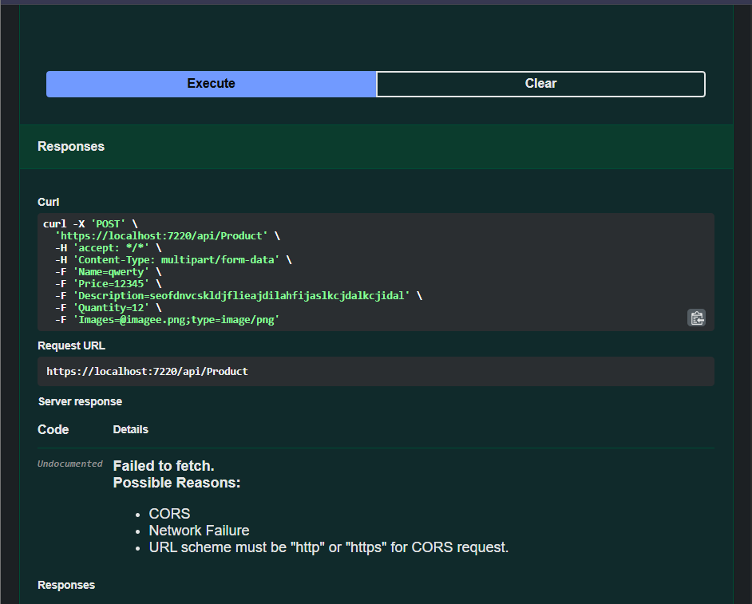
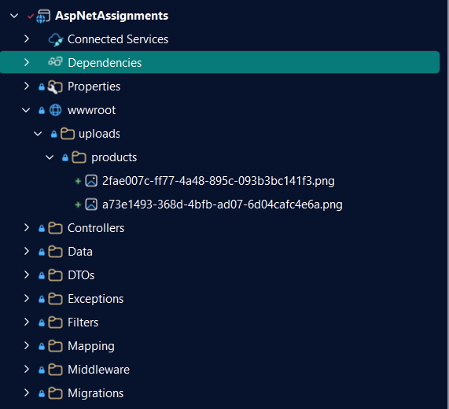
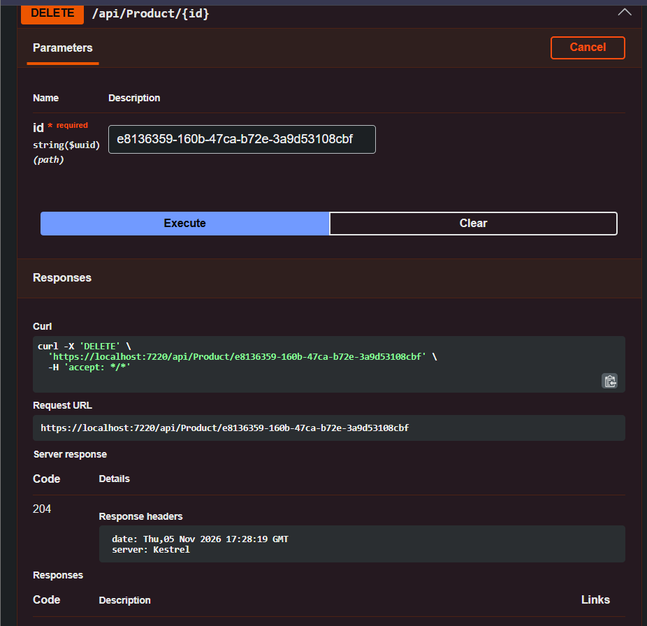

# ASP.NET Core Tasks
---
## 🗺️ Зміст
* [📌 Структура рішень](#-структура-рішень)
  * [1. AspNetAssignments (Головний проєкт)](#1-aspnetassignments-головний-проєкт)
  * [2. ExtraAspNetAssignments (Додатковий проєкт)](#2-extraaspnetassignments-додатковий-проєкт)
* [🗂️ Простори імен (Namespaces)](#-простори-імен-namespaces)
  * [1. AspNetAssignments (Головний проєкт)](#1-aspnetassignments-головний-проєкт-1)
  * [2. ExtraAspNetAssignments (Додатковий проєкт)](#2-extraaspnetassignments-додатковий-проєкт-1)
* [🌿 Робота з Git та гілками](#-робота-з-git-та-гілками-як-виконуєтсья-кожна-робота)
* [🚀 Остання влита робота](#-остання-влита-робота)

---

Репозиторій містить практичні, класні та домашні завдання з курсу ***ASP.NET Core (.NET 10, C#, Visual Studio 2026, Entity Framework Core)***.

Усі початкові завдання збережено в папці `/Archive`, після чого весь ключовий функціонал було централізовано та розбито на два структуровані рішення.

---

## 📌 Структура рішень

### 1. `AspNetAssignments` (Головний проєкт)
Сюди винесено весь функціонал сутностей, з якими велася систематична робота протягом курсу (багато використовували):

* **Product (Товар) & FluentValidation + Global Validation Filter**:
* **User (Користувач / Клієнт)**:
* **Order & OrderItem (Замовлення та позиції)**:

### 2. `ExtraAspNetAssignments` (Додатковий проєкт)
Сюди винесено тематичні сутності окремих практичних та домашніх завдань
* **Book (Книги)**
* **Invoice (Рахунки/Інвойси)**
* **Project & TaskItem (Проєкти та задачі)**
---
## 🗂 Простори імен (Namespaces)
Замість `<сутність>` требя замінити, на ту сутність, з якою треба працювати, але загальна назва, наприклад: `Product`
### 1. `AspNetAssignments` (Головний проєкт):
***Наразі існують такі сутності в цьому проєкті:***
* **Product -> `Product`**
* **Order & OrderTime -> `Order`**
* **User -> `User`**

Самі простори імен:

* **Data** — `using AspNetAssignments.Data;`
* **Models** — `using AspNetAssignments.Models.<сутність>;`
* **DTOs** — `using AspNetAssignments.DTOs.<сутність>;`
* **DTOs (Pagination)** — `using AspNetAssignments.DTOs.Pagination;`
* **DTOs (Common)** — `using AspNetAssignments.DTOs.Common;`
* **Validators** — `using AspNetAssignments.Validators.<сутність>;`
* **Services (Abstract)** — `using AspNetAssignments.Services.Abstract;`
* **Services** — `using AspNetAssignments.Services;`
* **Filters** — `using AspNetAssignments.Filters;`
* **Middleware** — `using AspNetAssignments.Middleware;` 
* **Controllers** — `using AspNetAssignments.Controllers;`
* **Mapping** — `using AspNetAssignments.Mapping;` 
* **Exceptions** — `using AspNetAssignments.Exceptions;` 
* **Root / Program** — `using AspNetAssignments;` 

### 2. `ExtraAspNetAssignments` (Додатковий проєкт):
***Наразі існують такі сутності в цьому проєкті:***
* **Book -> `Book`**
* **Invoice -> `Invoice`**
* **Project & TaskItem -> `Project`**

Самі простори імен:

* **Data** — `using ExtraAspNetAssignments.Data;`
* **Models** — `using ExtraAspNetAssignments.Models.<сутність>;`
* **DTOs** — `using ExtraAspNetAssignments.DTOs.<сутність>;`
* **DTOs** — `using ExtraAspNetAssignments.DTOs.<сутність>;`
* **Services (Abstract)** — `using ExtraAspNetAssignments.Services.Abstract;`
* **Services** — `using ExtraAspNetAssignments.Services;`
* **Controllers** — `using ExtraAspNetAssignments.Controllers;`
* **Mapping** — `using ExtraAspNetAssignments.Mapping;`
* **Root / Program** — `using ExtraAspNetAssignments;` 

---

## 🌿 Робота з Git та гілками, як виконуєтсья кожна робота:

* Для кожного нового завдання (класної, практичної чи домашньої роботи) створюється окрема тематична гілка 
  * `classwork-dd-mm-yyyy` 
  * `hw-dd-mm-yyyy`
  * `practice-dd-mm-yyyy` 
  
(Де, dd, mm та yyy - день, місяць та рік(повна дата), коли робили або дали завдання):  
* Усі логічно завершені етапи фіксуються атомарними коммітами за конвенцією **Conventional Commits**:  
  `feat: implement ValidationFilterAttribute for automated FluentValidation`, `feat: add RequestLoggingMiddleware with Stopwatch timing`, `feat: register global action filter in Program.cs` тощо.
* Після перевірки та тестування гілка зливається в основну гілку `main`.
 

---

## 🚀 Остання влита робота:

Остання актуальна робота, що була перевірена та влита в `main` (або не влита, та знаходиться в гілці hw-18-10-2026):

### Підтвердження виконання (Скріншоти та результати тестування) для практичної або домашньої роботи:

